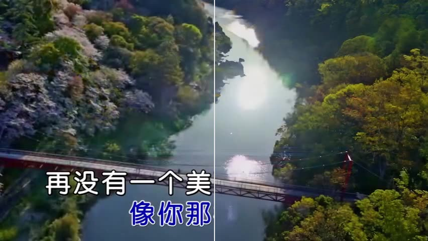

# HintErase

**Hint, Not Hole: Localization-Robust Video Overlay Removal**
Dongyang Zhang, Wei Zhang, Renjie Zou, Zhiwei Huang — Malanshan Audio & Video Laboratory

[**Project page**](https://zdyshine.github.io/HintErase/) · [**Technical report (PDF)**](docs/HintErase_report.pdf) · [BibTeX](#citation)



## Overview

Video overlay removal recovers the scene beneath burned-in subtitles, karaoke lyrics, title cards, end credits, logos and watermarks. In practice, where to remove comes from a detector or a segmenter, and that localization is wrong in both directions: it misses strokes, halos, whole frames and whole objects, and it covers background between characters, around boxes and on genuine scene text. Methods that treat the mask as a hole — regenerating what's inside and copying everything outside — inherit every one of these errors.

**HintErase** treats localization as a *hint*, not a *hole*. The model always sees the full, unmasked video together with a hint channel; during training the hint is corrupted the way real localizers actually fail, while supervision follows the true overlay region. The result is a single model that:

- removes overlay pixels the hint missed,
- keeps background pixels the hint wrongly covered, and
- is trained to keep genuine scene text even when the hint lands on it,

all with the same weights, whether the hint is an exact mask, a loose box, a partial mask, or just a coarse region.

For full-length releases, a streaming pipeline turns short clips into complete deliveries: deinterlacing, shot-cut detection, temporal hint repair, windowed inference with fixed memory, brightness-adaptive paste-back, and frame-exact output with the original audio.

## Results

The [project page](https://zdyshine.github.io/HintErase/) has video comparisons (input / hint / output side by side) covering:

- karaoke lyrics, title cards with logos, theme-song lyrics and end credits in animation
- the same weights run on five different hints for one clip (exact mask, eroded mask, mask with missing strokes, filled box, detection box) — showing why reading the hint as evidence, not a hole, matters
- a full multi-shot music video processed end to end by the long-video pipeline

The pipeline also supports optional Ultra-HD delivery — erasure at the source resolution followed by in-house 4x super-resolution — which is described on the page and in the report but not shown as footage, because the available sample clips feature identifiable people.

Details, the method, and the full pipeline are in the [technical report](docs/HintErase_report.pdf).

## Citation

```bibtex
@techreport{zhang2026hinterase,
  title       = {Hint, Not Hole: Localization-Robust Video Overlay Removal},
  author      = {Zhang, Dongyang and Zhang, Wei and Zou, Renjie and Huang, Zhiwei},
  institution = {Malanshan Audio \& Video Laboratory},
  year        = {2026},
  url         = {https://zdyshine.github.io/HintErase}
}
```

## License and usage note

This repository hosts the project page and technical report for HintErase. All clips shown on the project page are from licensed productions and are shown with the permission of their rights holders — please do not download or redistribute them. Overlay removal can be misused to strip watermarks or attribution from content you have no right to modify; this work was developed to re-release licensed content, and deployments should keep provenance metadata and restrict watermark removal to rights holders.

## For maintainers

See [DEV.md](DEV.md) for how the page is built, how to add a case, and how to publish updates.
